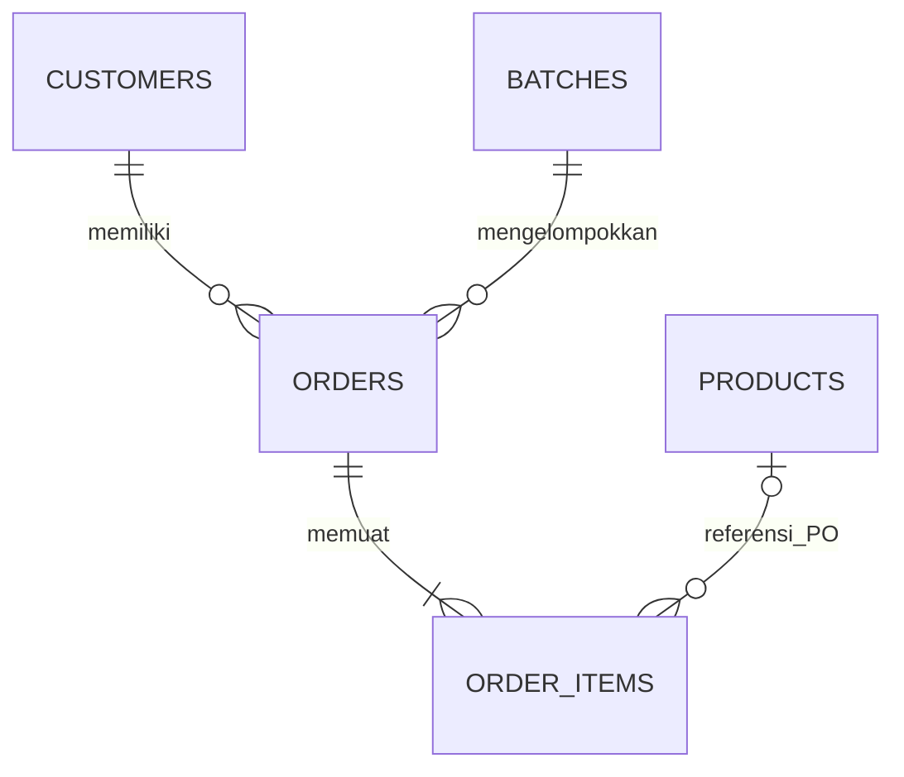

# Kebutuhan data — Tippo

Dokumen ini membedakan **field prototipe v3 lokal** dari **rancangan tahap berikutnya**. Sumber tipe: [types.ts](../src/lib/types.ts); perhitungan: [finance.ts](../src/lib/finance.ts); migrasi: [migration.ts](../src/lib/migration.ts). Integrasi akun memakai Supabase Auth dan RPC dengan migration JSONB/RLS yang diuji lokal. Penerapan serta verifikasi proyek remote belum dilakukan; belum ada langganan berbayar produksi.

## Penyimpanan v3 dan kompatibilitas v1/v2

`AppData` berisi `batches`, `customers`, `products`, dan `orders`. Setiap pesanan memiliki array `items` dengan 1–100 barang/makanan, timestamp pembuatan, dan pembayaran kumulatif tingkat pesanan. Tidak ada ledger pembayaran atau rincian biaya batch. Key localStorage **`tippo.workspace.v1`** tetap menyimpan `AppData` langsung agar data lama ditemukan. Status paket demo disimpan terpisah.

Ekspor memakai **`{schemaVersion: 3, exportedAt: ISOtimestamp, data: AppData}`**. `exportedAt` ialah waktu ekspor, bukan waktu transaksi. Impor menerima envelope versi 1, 2, atau 3 maksimal 10 MB, memvalidasi data, dan mengganti workspace setelah konfirmasi. Reset/muat ulang contoh juga membutuhkan konfirmasi. Backup transaksi tidak mengekspor status Pro dan tidak dapat mengaktifkan Pro.

`normalizeAppData` menerima v3 atau memigrasikan v1/v2. Satu produk order lama menjadi satu `OrderItem` dengan ID stabil `legacy-item-<id order>`, atribut varian/warna/ukuran kosong, dan snapshot nominal/label yang sama. Tanggal, status, pelanggan, batch, DP, jasa, serta ongkir tidak berubah. `createdAt` lama diperkirakan sebagai tengah malam Asia/Jakarta pada `date`, karena format lama belum mencatat waktu pembuatan sebenarnya. Perkiraan ini hanya untuk kompatibilitas, bukan audit historis.

V1 yang belum memiliki `products` membentuk master PO berdasarkan label produk persis di seluruh batch PO. Harga default mengikuti order pertama; harga tiap item historis tetap sendiri. ID master `legacy-product-<id order pertama>`, status aktif. V2 mempertahankan master/referensi yang sudah ada. Nama lama tidak ditebak menjadi varian/SKU. Migrasi tidak memasukkan demo, tidak mengubah nominal, dan dapat diulang tanpa menggandakan item/master.

Saat belum ada storage valid, aplikasi memakai data contoh. Penanda **Data contoh** diturunkan dari adanya ID order bawaan yang masih tersisa, bukan field `isDemo`. Reload dengan data lokal valid tidak membuat ulang demo. Jika penulisan localStorage gagal, state sementara tetap tampil dengan peringatan untuk mengekspor sebelum menutup.

Seluruh nominal berupa rupiah integer, bukan float. Tanggal transaksi memakai `YYYY-MM-DD`; timestamp pembuatan pesanan dan paket berupa ISO. Bulan kuota serta bulan berjalan ringkasan memakai **Asia/Jakarta**, terpisah dari tanggal transaksi. Zona waktu usaha belum dapat dikonfigurasi. ID stabil diperlukan untuk relasi dan alokasi deterministik; ID item unik di seluruh workspace.

### Pelanggan — `Customer`

| Field | Tipe | Arti / validasi |
| --- | --- | --- |
| `id` | string | Unik, stabil |
| `name` | string | Wajib; trim; nama pelanggan |
| `phone` | string | Opsional sebagai string kosong; nomor tidak disimpan sebagai angka |

Pelanggan baru dapat dibuat dari form pesanan. Nama boleh sama; nomor telepon bukan identitas wajib. Ringkasan pelanggan dihitung dari pesanan, bukan nilai saldo tetap.

### Batch — `Batch`

| Field | Tipe | Arti / validasi |
| --- | --- | --- |
| `id` | string | Unik, stabil |
| `name` | string | Wajib; nama perjalanan/periode |
| `type` | `jastip` / `po` | Jenis; `po` ditampilkan sebagai open PO |
| `origin` | string | Asal belanja/lokasi |
| `closeDate` | string tanggal | Tenggat; `YYYY-MM-DD` valid |
| `status` | `open` / `closed` / `completed` | Dibuka / ditutup / selesai |
| `directCosts` | number rupiah | Total biaya langsung batch; integer ≥ 0 |

Tidak ada tanggal buka atau detail pengeluaran MVP. `directCosts` merupakan satu total yang mencakup ongkir pemasok, transport khusus belanja, bea masuk, kemasan, atau biaya langsung lain. Biaya yang ditagihkan kepada pelanggan masuk pendapatan pesanan; jangan mencampurnya dengan biaya usaha. Perubahan biaya/kuantitas menghitung ulang alokasi. Penutupan batch tidak melunasi atau menyelesaikan order otomatis.

### Master produk Open PO — `Product`

| Field | Tipe | Arti / validasi |
| --- | --- | --- |
| `id` | string | Unik, stabil; tidak berubah ketika nama/harga diedit |
| `name` | string | Nama produk wajib |
| `variant` | string | Varian opsional, misalnya ukuran/warna; satu master per kombinasi |
| `sku` | string | SKU opsional; tidak menjadi ID relasi |
| `unitPrice` | number rupiah | Harga jual default per unit; integer ≥ 0 |
| `unitCost` | number rupiah / `null` | Harga beli default per unit; integer ≥ 0 atau belum diketahui |
| `active` | boolean | Produk aktif dapat dipilih pesanan baru; false berarti arsip |

Master milik alur Open PO. Jastip tetap memakai nama/harga bebas karena barang dapat berbeda setiap titipan. Arsip menggantikan penghapusan agar relasi pesanan lama tetap valid. SKU opsional; form menolak SKU yang sudah dipakai master lain tanpa membedakan huruf besar/kecil, termasuk produk arsip. Relasi pesanan tetap memakai `id`, bukan SKU. Backup JSON lama dapat memuat SKU duplikat; importer Excel menolak pencocokan SKU ambigu sebelum menyimpan. Persediaan, foto, katalog publik, serta generator kombinasi varian belum didukung.

### Pesanan — `Order`

| Field v3 | Tipe | Arti / validasi |
| --- | --- | --- |
| `id` | string | Unik, stabil |
| `batchId` | string | Referensi batch yang tersedia |
| `customerId` | string | Referensi pelanggan yang tersedia |
| `items` | `OrderItem[]` | 1–100 snapshot item; wajib, tidak kosong |
| `createdAt` | string timestamp ISO | Waktu pencatatan; tidak dapat diedit melalui form; dasar kuota bulanan |
| `serviceFee` | number rupiah | Jasa total pesanan, bukan per unit; ≥ 0 |
| `shippingCharge` | number rupiah | Ongkir yang ditagihkan pelanggan; ≥ 0 |
| `paid` | number rupiah | Pembayaran kumulatif; 0 ≤ paid ≤ total tagihan |
| `date` | string tanggal | Tanggal transaksi yang dapat diedit; dasar ringkasan finansial, bukan kuota |
| `status` | enum | `new`, `purchased`, `ready`, `shipped`, `done`, `cancelled` |
| `notes` | string | Catatan; opsional sebagai string kosong |

### Item pesanan — `OrderItem`

| Field v3 | Tipe | Arti / validasi |
| --- | --- | --- |
| `id` | string | Unik di seluruh workspace; stabil saat item diedit |
| `productId` | string / `null`, opsional | Referensi master PO; jastip tidak memakai master |
| `product` | string | Snapshot nama barang/makanan wajib |
| `variant` | string | Varian opsional per barang; PO mengikuti varian master |
| `color` | string | Warna jastip opsional |
| `size` | string | Ukuran jastip opsional |
| `quantity` | integer | Jumlah unit positif |
| `unitPrice` | integer rupiah | Harga jual per unit ≥ 0 |
| `unitCost` | integer rupiah / `null` | Harga beli per unit ≥ 0, atau belum diketahui |

Item menyimpan snapshot transaksi, bukan pembacaan langsung dari master. PO menyalin nama/varian/harga master aktif. Perubahan master tidak mengubah omzet/HPP/tagihan historis; edit mempertahankan snapshot item yang tidak berganti master. Item baru memakai nilai master saat ditambahkan. Arsip tetap merupakan referensi valid untuk item lama, tetapi tidak dapat dipilih untuk item baru. Satu pelanggan dapat memesan produk yang sama dengan pilihan jastip berbeda pada baris yang berbeda.

`unitCost = null` berarti belum dicatat; `0` berarti biaya beli nol yang eksplisit. MVP tidak memiliki harga estimasi dan aktual yang terpisah. Nominal `paid` tidak mempunyai tanggal, metode, atau riwayat pembayaran. Edit **Sudah dibayar** mengisi total kumulatif terbaru, bukan nominal setoran tambahan. Pembatalan berbayar ditolak sampai refund tersedia; tagihan tidak boleh lebih rendah daripada nilai `paid` yang disimpan.

Form pesanan baru hanya menerima batch `open` dengan jenis sesuai alur: jastip memilih batch `jastip`, PO memilih batch `po`. Edit order lama boleh mempertahankan batch asal yang kini `closed`/`completed`, tetapi tidak memindahkan order ke batch tertutup lainnya. Detail tambahan form PO menampung tanggal, ongkir tagihan, dan catatan; jasa lama juga tampil pada pesanan migrasi dengan jasa tercatat. Alur utama hanya meminta batch, produk, pelanggan, jumlah, dan DP. Harga PO tampil sebagai ringkasan, bukan input; harga beli transaksi lama dapat dilengkapi melalui HPP & Margin.

## Relasi v3



Referensi batch/pelanggan harus valid. `items[].productId` wajib menunjuk master yang tersedia dan order berada pada batch PO; arsip tidak membuat relasi invalid. Data dengan transaksi tidak dihapus dengan meninggalkan relasi rusak. Semua ID item wajib unik, termasuk pada order berbeda. Referensi tampilan invoice bukan nomor urut faktur resmi.

## Perhitungan yang dipakai MVP

```text
Subtotal(order) = Σ(item.quantity × item.unitPrice) + serviceFee
Revenue(order) = Subtotal(order) − Discount(order) + shippingCharge
NetSales(order) = max(0, Subtotal(order) − Discount(order))
HPP(order) = Σ(item.quantity × item.unitCost) + allocatedBatchCost
Margin(order) = NetSales(order) − HPP(order)
Outstanding(order) = Revenue(order) − paid
```

Pesanan dibatalkan dikecualikan; HPP/margin/piutang aktifnya nol. Jika harga beli sedikitnya satu item kosong, HPP dan margin order `null`, bukan nol. Jasa, ongkir, dan DP berada pada order sehingga tidak terhitung ulang per item. Biaya batch dialokasikan menurut total kuantitas semua item order aktif, meski ada harga beli kosong atau tanggal order berbeda bulan.

### Alokasi biaya batch

Untuk biaya `C`, jumlah unit aktif `Q`, dan total kuantitas item pesanan `q`, kuota biaya adalah `C × q / Q`. Ambil bagian bulat bawah; bagikan sisa rupiah ke kuota dengan sisa terbesar. ID menaik menentukan seri. Hasil tidak berubah karena tabel disortir dan total alokasi tepat sama dengan biaya batch.

Jika `Q = 0`, tidak ada alokasi. Biaya tetap berada pada batch. Pembatalan atau perubahan jumlah menghitung ulang semua alokasi aktif dalam batch. Semua nominal/hasil perkalian harus berada dalam batas integer aman; input dan impor perlu membatasi angka yang terlalu besar.

### Ringkasan bulanan — `MonthSummary`

| Field hasil | Arti tepat |
| --- | --- |
| `revenue` | Omzet semua order tidak dibatalkan dengan `date` pada bulan terpilih |
| `hpp` | Subtotal HPP hanya dari order dengan harga beli seluruh item diketahui |
| `profit` | Subtotal laba hanya dari order dengan harga beli seluruh item diketahui |
| `received` | Jumlah `paid` pada kelompok order bulan terpilih, tanpa tanggal pembayaran |
| `outstanding` | Piutang kelompok order bulan terpilih |
| `ordersCount` | Jumlah order aktif pada kelompok bulan |
| `unknownCostCount` | Jumlah order dengan sedikitnya satu item yang harga belinya belum tercatat |

Data `MonthlyPoint` menambahkan `month` (`YYYY-MM`) dan label untuk 12 bulan dalam tahun terpilih. UI grafik menampilkan jendela enam bulan yang memuat bulan terpilih; Januari–Juni memakai jendela Januari–Juni dengan pilihan bulan ditandai. Label `received` berarti **Pembayaran untuk pesanan bulan ini**, bukan arus kas masuk bulan ini. Pelunasan Oktober untuk order September meningkatkan kelompok September. Laporan arus kas berdasarkan tanggal pembayaran belum didukung.

Paket Gratis hanya merender titik dan ringkasan bulan berjalan Jakarta. Bulan historis tidak ditampilkan melalui opsi periode, grafik, label aksesibilitas, atau tabel ringkasan. Pro demo boleh memakai seluruh periode. Operasi order historis tetap tersedia pada Gratis.

## Paket dan kuota demo

Status lokal pada key **`tippo.subscription.demo.v1`** berbentuk `{tier: "free" | "pro", expiresAt: ISOtimestamp | null, mode: "demo"}`. Pro berlaku hanya jika kedaluwarsa valid dan berada di masa depan. Harga yang ditampilkan **Rp25.000/bulan**, tetapi aktivasi **Coba Pro (demo)** tidak menerima/menagih pembayaran. Lama demo satu bulan kalender; tanggal akhir mengikuti hari yang tersedia pada bulan tujuan. Status tidak dimasukkan ke backup transaksi.

Gratis memiliki dua kuota terpisah: **5 pesanan jastip dan 5 pesanan PO per bulan kalender Asia/Jakarta**. Jenis berasal dari batch, dan bulan pembuatan berasal dari `createdAt`, bukan `date`. Semua status, termasuk dibatalkan, tetap dihitung; edit tidak menambah kuota. Banyak item dalam satu order tetap satu slot. Impor Excel menghitung order setelah penggabungan dan diperiksa atomik sebelum menyimpan. Pergantian bulan membuka kuota baru tanpa menghapus data.

Ledger lokal **`tippo.usage.demo.v1`** berisi `{orderId, type: "jastip" | "po", month: "YYYY-MM"}[]`, tanpa nama/telepon/harga. ID pembuatan pertama menjadi acuan agar restore tidak menggeser bulan/jenis pemakaian. Pemakaian menggabungkan workspace dengan ledger menurut ID unik. Ledger tidak dibersihkan oleh pengosongan/reset data transaksi; restore ID dikenal tidak memakai slot kembali, sementara ID baru bulan berjalan harus memenuhi kuota. Contoh bawaan dikecualikan dari pencatatan ledger agar pengguna dapat mulai dari workspace kosong. Backup transaksi tidak mengganti ledger maupun status langganan.

Gratis membatasi `products.length` menjadi lima master PO, termasuk arsip. Mengarsipkan tidak mengosongkan slot. Setelah turun paket, data di atas batas tetap dipertahankan tetapi master baru tidak dapat dibuat. Pro menghapus kuota paket; batas teknis jumlah record/item tetap berlaku.

Pemeriksaan browser membantu pengalaman demo, tetapi bukan kontrol langganan produksi: pengguna dapat mengubah storage/jam perangkat. Produksi membutuhkan waktu server, kepemilikan akun, entitlement tervalidasi, transaksi kuota server/database, serta webhook pembayaran yang terverifikasi dan idempotent. Impor/restore/reset juga memerlukan kebijakan kuota server agar tidak memintas langganan.

## Invoice untuk WhatsApp

Invoice adalah teks turunan dari snapshot pesanan, pelanggan, dan batch; tidak menjadi entitas tagihan baru. Memuat seluruh label/pilihan item, jumlah/harga jual/subtotal, jasa, ongkir, total, DP kumulatif, serta sisa. `unitCost`, HPP, margin, biaya batch, dan catatan internal dikecualikan. Menyalin tidak mengubah pembayaran/status dan tidak mengirim pesan. Bila Clipboard API tidak tersedia, textarea tetap dapat disalin manual. Pembatalan tidak menghasilkan tagihan aktif.

Jika `unknownCostCount > 0`, HPP dan laba merupakan subtotal parsial yang harus diberi label **belum lengkap**. Jangan memakai `revenue − hpp` dari semua order untuk mengklaim laba bulanan lengkap. Jika seluruh harga beli tersedia, angka tetap merupakan **perhitungan sementara dari biaya tercatat**, karena tidak ada flag aktual/estimasi atau konfirmasi biaya batch final.

## Validasi, ekspor, dan privasi

- Text di-trim; nama pelanggan/produk dan batch wajib. Nomor telepon mempertahankan digit awal `0`.
- Nominal integer nonnegatif; jumlah integer positif. Tolak `NaN`, infinity, dan angka di luar batas aman. Validator juga memeriksa overflow total tagihan, pembelian, kuantitas agregat, biaya batch, dan perkalian bobot alokasi.
- Tanggal `YYYY-MM-DD` harus benar-benar valid; hindari konversi UTC yang menggeser hari.
- Relasi ID, keunikan ID per entitas, enum status, tanggal, serta saldo `paid ≤ tagihan` divalidasi saat penyimpanan dan impor. Order `cancelled` wajib memiliki `paid = 0`. Batas jumlah record: 10.000 batch, 10.000 pelanggan, 100.000 master produk, dan 100.000 order.
- Impor JSON menolak file tidak valid atau di atas 10 MB lalu meminta konfirmasi penggantian data. Ekspor tersedia sebelum reset; mulai kosong dan muat ulang demo memerlukan konfirmasi. Belum ada preview rinci record impor.
- Reload tidak membuat ulang demo jika data lokal valid sudah ada. Data contoh yang masih tersisa ditandai agar tidak tertukar dengan transaksi usaha.
- Browser perangkat lain tidak berbagi data; penghapusan storage browser menghapus data lokal. Ekspor JSON menjadi salinan manual, bukan cadangan otomatis.
- Nama/telepon pelanggan merupakan data pribadi. Ekspor hanya memuat data aplikasi, bukan secret. Pengguna perangkat bersama dapat mengakses penyimpanan browser ini.

## Input massal dari Excel

Import Excel menambahkan pesanan baru pada satu batch `open` sesuai jenis layar. File `.xlsx` dibatasi 5 MB dan 1.000 baris barang; maksimal 100 item per order. Jastip memakai barang/harga/pilihan bebas. PO memakai SKU atau nama+varian dan lembar master aktif; harga master disalin ke snapshot dan tidak diganti lewat Excel.

| Template | Kolom pada lembar `Pesanan` |
| --- | --- |
| Jastip | `nomor_pesanan`, `nama_pelanggan`, `telepon`, `produk`, `varian`, `warna`, `ukuran`, `jumlah`, `harga_jual`, `harga_beli`, `fee_jastip`, `ongkir`, `dp`, `tanggal`, `catatan` |
| Open PO | `nomor_pesanan`, `nama_pelanggan`, `telepon`, `sku_produk`, `produk`, `varian`, `jumlah`, `ongkir`, `dp`, `tanggal`, `catatan` |

`nama_pelanggan`, `jumlah`, dan `tanggal` wajib; Jastip juga mewajibkan `produk` dan `harga_jual`. PO membutuhkan `sku_produk` atau nama `produk` + `varian` yang sama persis dengan master aktif. Tanggal menerima teks `YYYY-MM-DD` atau tanggal Excel. Telepon/SKU berupa teks agar nol awal tetap tersimpan; nominal berupa angka bulat tanpa pemisah ribuan yang diketik sebagai teks. Harga beli jastip kosong menjadi `null`; ongkir, DP, dan fee yang kosong menjadi nol. Baris contoh harus diganti atau dihapus; nama pelanggan contoh ditolak saat impor.

`nomor_pesanan` yang sama menggabungkan baris menjadi satu order; kosong menjadikan tiap baris order terpisah. Nomor ini hanya kunci penggabungan file dan tidak mengganti ID order yang dibuat aplikasi. Pelanggan/telepon/tanggal/jasa/ongkir/DP/catatan dapat ditulis sekali lalu diwariskan kepada baris lanjutan kosong; nilai eksplisit yang berbeda ditolak. Jasa, ongkir, dan DP sekali per grup. `createdAt` setiap order ditentukan saat konfirmasi, sehingga tanggal lama tidak memintas kuota bulan ini.

Pelanggan yang cocok dipakai kembali tanpa menimpa nama/telepon. Nama+telepon ambigu ditolak; pelanggan baru dibuat saat konfirmasi. Grup menjadi order baru berstatus `new`, bukan pembaruan order lama. Formula, termasuk hasil formula tersimpan, ditolak. File dibaca lokal. Batch, master, pelanggan, serta kuota diperiksa ulang saat konfirmasi. Perubahan harga setelah pratinjau membutuhkan unggah ulang untuk meninjau total baru.

Pencocokan produk PO harus menghasilkan tepat satu master aktif: SKU yang ambigu, nama/varian yang ambigu, produk tidak dikenal, atau produk arsip ditolak. Validasi numerik, tanggal, total pembayaran, batas integer aman, dan relasi sama dengan input form. Pratinjau menunjukkan masalah menurut baris, lalu konfirmasi menyimpan seluruh hasil secara atomik. Jika ada baris invalid atau batch tidak lagi terbuka, tidak ada pesanan yang ditambahkan. Excel bukan backup workspace dan tidak mengganti data lama; pemulihan JSON tetap menjadi alur terpisah.

## Model konseptual Supabase — tahap berikutnya

Model berikut **belum menjadi field prototipe atau migration yang dijalankan**:

| Entitas masa depan | Kebutuhan tambahan |
| --- | --- |
| `businesses` / pemilik | Identitas pemilik, mata uang, zona waktu |
| `customers` | FK pemilik, nama/telepon, catatan, timestamp |
| `batches` | FK pemilik, jenis/status, tanggal buka/tutup, asal |
| `products` | FK pemilik, nama/varian/SKU, harga default, arsip, timestamp |
| `orders` | FK pelanggan/batch/pemilik, tanggal, status, jasa/ongkir, timestamp |
| `order_items` | Normalisasi array item yang sudah tersedia lokal; snapshot nama/varian/warna/ukuran/kuantitas/harga, harga beli estimasi dan aktual |
| `payments` | FK order, nominal, tanggal bayar, metode, timestamp; menggantikan `paid` sebagai sumber data |
| `batch_expenses` | FK batch, jenis/label biaya, nominal, tanggal, flag estimasi/aktual |
| `refunds` | FK pembayaran/order, nominal, tanggal, alasan dan audit |
| `subscriptions` | FK pemilik, paket, periode aktif, status, referensi pelanggan/langganan provider |
| `subscription_events` | ID webhook unik, signature terverifikasi, payload minimum, hasil proses idempotent |
| `monthly_usage` | Pemilik + jenis jastip/PO + bulan Jakarta, jumlah pencatatan; transaksi atomik dan waktu server |

Ledger `payments` memungkinkan laporan kas menurut tanggal pembayaran. Migrasi `paid` tidak boleh menciptakan tanggal pembayaran fiktif: tandai saldo awal migrasi. Array `items` yang sudah ada dipetakan menjadi `order_items` tanpa menggandakan pembayaran. Timestamp pembuatan lama yang diperkirakan jangan diperlakukan sebagai waktu server yang terverifikasi.

Setiap tabel memakai UUID, timestamp server, foreign key, dan check constraint. Tambahkan `owner_id` yang mengacu `auth.users.id` untuk satu pemilik, atau `business_id` dan keanggotaan bila multiuser diperlukan. Aktifkan RLS sebelum akses client; policy memverifikasi pemilik/keanggotaan sama, termasuk relasi lintas tabel. Kunci `service_role` hanya berada server, tidak di browser, ekspor, atau localStorage. URL Supabase serta publishable/anon key dimasukkan melalui Environment Settings setelah proyek tersedia.

Nominal memakai integer/bigint dengan batas jelas. Index awal: pemilik + tanggal order, batch ID, pelanggan ID, dan tanggal pembayaran. Total pembayaran/perubahan tagihan menggunakan transaksi database agar request bersamaan tidak melampaui tagihan. Refund tetap record terpisah dengan audit; jangan menghapus pembayaran asli.

Migrasi browser: ekspor snapshot, validasi versi/relasi, preview jumlah record/total nominal, lalu impor idempotent dengan ID stabil setelah login. Pertahankan snapshot lokal hingga hasil terverifikasi. Status sinkronisasi serta kegagalan jaringan harus terlihat. Cadangan terenkripsi, retensi, dan penghapusan akun menjadi kebutuhan tahap online.

## Penyimpanan akun Supabase

Demo tetap memakai AppData v3 lokal. Akun memakai `tippo_workspaces`, dengan
`owner_id` yang mereferensikan `auth.users`, `data` JSONB v3, `version`,
`pro_until`, dan `updated_at`. Snapshot JSONB dipilih agar histori item dan
backup v3 tetap konsisten tanpa migrasi antarformat transaksi pada tahap ini.
Untuk volume besar, tabel transaksi dapat dinormalisasi pada tahap berikutnya.

`tippo_order_usage` mempunyai primary key `(owner_id, order_id)`, jenis, dan
waktu server. RLS membatasi baca ke pemilik. Tulis langsung oleh anon atau
authenticated ditolak; get/save RPC memperoleh pemilik dari `auth.uid()`.
Row lock dan versi mencegah overwrite lintas perangkat. Save memvalidasi
relasi, nominal, jumlah barang, pembayaran, dan kuota lalu menyimpan atomik.
Entitlement hanya dapat diubah layanan server dengan hak yang sesuai.

Data akun tidak ditulis ke key browser demo dan tidak memakai entitlement demo.
Reset tidak menghapus usage. ID yang dikenal memulihkan waktu/jenis asli; ID
baru memakai waktu pembuatan server, bukan timestamp dari berkas. HPP tetap
dihitung dari snapshot item, fee/ongkir/DP sekali per pesanan.

Migration dan batas verifikasi remote: [SUPABASE-SETUP.md](./SUPABASE-SETUP.md).

## Kategori dan refund

`Product.category?: string` menyimpan kategori opsional maksimal 80 karakter. `Order.refunds?: { id: string; amount: number; date: string; reason: string; createdAt: string }[]` menyimpan riwayat pengembalian; maksimal 100 entri dengan ID unik dan nominal positif. `Order.paid` tetap pembayaran bersih yang masih diterima setelah refund. Total pembayaran sebelum refund dapat direkonstruksi dari `paid + sum(refunds.amount)`.

Data lama tanpa dua properti opsional tetap valid. Kedua properti disimpan dalam JSON workspace melalui RPC versi yang sudah ada, bersama nominal pembayaran dalam satu penyimpanan. Tidak memerlukan migrasi database baru. Validasi klien memeriksa riwayat; ledger ini bukan audit trail immutable yang ditegakkan server. Invariant backend pesanan dibatalkan dengan pembayaran nol tetap dipenuhi.


## Margin tanpa ongkir pelanggan

Margin pesanan = max(0, subtotal produk + fee − diskon) − HPP. Ongkir yang ditagihkan kepada pelanggan tidak membentuk margin. Diskon rupiah mengurangi produk/fee terlebih dahulu; kelebihan diskon hanya mengurangi ongkir, sehingga dasar margin tidak menjadi negatif akibat diskon ongkir. HPP tetap dapat membuat margin negatif. Nilai belum lengkap dan pesanan dibatalkan tetap mengikuti aturan sebelumnya.

Total tagihan/penjualan dan sisa pembayaran tetap mencakup ongkir. Ringkasan margin, form Jastip, HPP & Margin, laporan penjualan, dan Excel penjualan memakai dasar tanpa ongkir yang sama. Rekap belanja per produk/per pesanan sejak awal menghitung harga produk saja. Data transaksi tidak ditulis ulang dan tidak memerlukan migrasi SQL.
