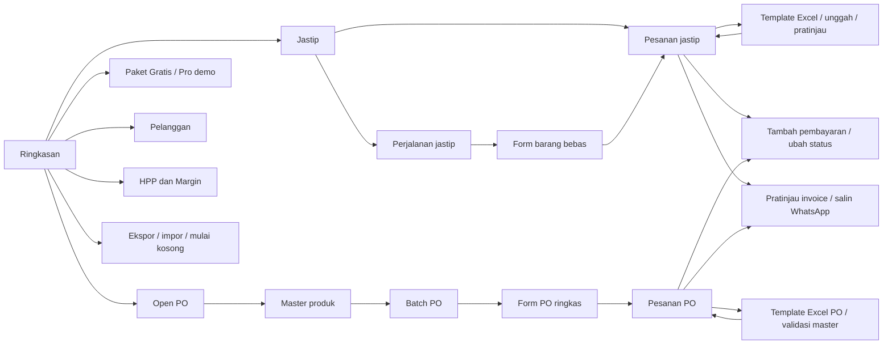

# PRD — Tippo

Status: website MVP dengan demo lokal v3 serta integrasi Supabase Auth/RPC. Migration dan akses proyek remote belum diverifikasi; pembayaran langganan belum tersedia. Bahasa: Indonesia. Mata uang: rupiah (IDR). Zona waktu kuota: Asia/Jakarta.

## Tujuan produk

Tippo membantu pemilik usaha jastip dan open pre-order mencatat pesanan dengan cepat, mengetahui tagihan yang belum lunas, serta memahami omzet, HPP, dan laba kotor setiap bulan. Pengguna utama adalah satu pemilik usaha kecil yang menerima pesanan melalui chat dan mengelola beberapa perjalanan atau periode PO sekaligus.

Masalah yang diselesaikan: pesanan dan DP tersebar di chat; biaya pembelian sering terlewat; omzet, pembayaran, serta laba mudah tertukar; input di ponsel terlalu panjang.

## Batas MVP

| Wajib MVP | Dikerjakan kemudian |
| --- | --- |
| Dashboard omzet, HPP, laba kotor, pembayaran pesanan, dan piutang | Ledger pembayaran bertanggal dan laporan arus kas berdasarkan tanggal pembayaran |
| Grafik bulanan omzet dan HPP; pilihan bulan | Akuntansi formal, laporan pajak, dan rekonsiliasi bank |
| Menu Jastip/Open PO terpisah; pesanan banyak barang/makanan; varian, warna, ukuran jastip | Diskon, bundel, serta impor chat WhatsApp |
| Master produk PO dengan varian, SKU, harga jual/beli, serta arsip | Persediaan, katalog publik, foto produk, dan kombinasi varian otomatis |
| Form PO ringkas: pilih produk, pelanggan, jumlah, batch, dan DP; harga otomatis | Penyesuaian harga massal dan promo |
| Tiga template/import Excel: produk, pesanan jastip, dan pesanan PO; validasi dan pratinjau | Impor chat, Google Sheets langsung, serta mapping kolom bebas |
| Invoice seluruh item yang bisa disalin ke WhatsApp | Pengiriman otomatis, PDF, penomoran invoice resmi, dan pajak |
| Aturan Gratis dan Pro Rp25.000/bulan, dengan simulasi aktivasi Pro | Pembayaran berulang, webhook, entitlement server, serta audit langganan produksi |
| Batch jastip/open PO dengan tenggat, status, dan asal | Rincian biaya batch, pembeda biaya estimasi/aktual, serta penguncian periode |
| Daftar pesanan, pencarian, status, serta pencatatan tambahan pembayaran | Refund/retur sebagian dan pembayaran online |
| Data pelanggan dasar dan ringkasan pesanan | CRM, loyalty, pemasaran, dan notifikasi otomatis |
| HPP dari harga beli per barang × jumlah | Persediaan dan metode alokasi lanjutan |
| Demo browser, ekspor/impor JSON, akun Supabase Auth, RPC, dan migration RLS | Penerapan/verifikasi remote, cadangan otomatis, dan multiuser |
| Responsif untuk ponsel dan desktop | Multiuser, banyak toko, banyak mata uang, dan aplikasi native |

Demo tidak membutuhkan Supabase dan memakai data contoh di browser. Website akun memakai proyek Supabase pengguna, dimulai kosong, dan menyimpan melalui RPC. Migration RLS/kuota sudah tersedia dan diuji lokal; penerapan serta verifikasi remote masih membutuhkan langkah dalam SUPABASE-SETUP.md.

## Kebutuhan utama

### Jastip: barang bebas dan perjalanan

Menu **Jastip** membuka tampilan khusus dengan tab **Perjalanan** dan **Pesanan**. Tombol **Pesanan jastip baru** membuka form pelanggan dan batch dengan satu atau lebih barang/makanan. Setiap barang memiliki nama, varian opsional, warna opsional, ukuran opsional, jumlah, harga jual per unit, serta harga beli yang boleh belum diketahui. **Tambah barang** menambah baris; barang tambahan dapat dihapus sebelum disimpan. Pelanggan baru dapat ditambahkan langsung. Nominal memakai IDR. Jenis batch mengikuti halaman Jastip.

Field wajib: pelanggan, batch, tanggal pesanan, dan sedikitnya satu item dengan nama, jumlah positif, serta harga jual. Maksimal 100 item dalam satu pesanan. Varian, warna, dan ukuran dicatat per item, bukan sebagai master jastip. Jasa, ongkir, DP, status, dan catatan berlaku sekali untuk seluruh pesanan; jasa/ongkir/DP awal nol. DP tidak boleh melebihi total seluruh item plus jasa dan ongkir. Penyimpanan langsung memperbarui daftar dan dashboard. Pembayaran diperbarui melalui **Sudah dibayar** dengan total kumulatif; MVP belum menyimpan tanggal setiap pembayaran.

Pesanan baru hanya menerima batch berstatus dibuka. Jika belum ada batch aktif, alur mengarahkan pengguna membuat batch. Order lama tetap dapat diedit pada batch asal yang sudah ditutup/selesai; pemindahan ke batch lain hanya tersedia jika batch tujuan masih dibuka.

### Open PO: master produk dan form ringkas

Menu **Open PO** membuka tampilan sendiri dengan tab **Produk**, **Pesanan**, dan **Batch PO**. Tab Produk tampil pertama agar katalog siap sebelum menerima pesanan. Pemilik membuat master sekali: nama, varian opsional, SKU opsional, harga jual, dan harga beli yang boleh belum diketahui. Satu kombinasi varian dibuat sebagai satu master. SKU yang diisi harus unik tanpa membedakan huruf besar/kecil saat disimpan melalui form. Master dapat diedit, diarsipkan, atau diaktifkan kembali; arsip menjaga relasi pesanan lama.

Tombol **Pesanan PO baru** membuka pilihan **Batch PO**, **Pelanggan**, lalu satu atau lebih baris **Produk** dan **Jumlah barang**, serta **Sudah dibayar**. **Tambah barang** memungkinkan pelanggan memesan beberapa produk/varian master sekaligus. Nama serta harga jual/beli tiap item diambil dari master dan ditampilkan sebagai ringkasan. Tanggal, ongkir, dan catatan berada pada **Detail tambahan (opsional)**; biaya jasa lama tetap tersedia untuk pesanan migrasi. Ongkir/DP tetap dicatat sekali untuk keseluruhan pesanan. Pelanggan baru dapat dibuat langsung. Pilihan batch tidak mencampur jastip dan PO. Harga master diedit melalui Produk; harga beli transaksi lama dilengkapi di HPP & Margin.

Setiap item menyimpan snapshot nama/varian dan harga ketika dibuat. Mengubah master hanya memengaruhi pemilihan baru; snapshot item lama tetap sama saat item yang dipilih tidak berubah. Menambahkan item baru pada edit mengambil harga master terbaru tanpa mengganti item lama. Produk arsip tidak dapat dipilih untuk item baru; item lama yang merujuk produk arsip tetap dapat dipertahankan saat pembayaran/status diedit.

Di Ringkasan atau halaman bersama, **Pesanan baru** meminta pilihan **Pesanan jastip** atau **Pesanan PO** sebelum membuka form yang sesuai. Pilihan ini menjadi awal alur, bukan field jenis di dalam form.

### Import Excel produk

Pada **Open PO → Produk → Import produk Excel**, pengguna mengunduh
`tippo-template-produk.xlsx`, menyalin listing produk lama ke lembar `Produk`,
menyimpan file .xlsx, lalu mengunggah dan memeriksa pratinjau sebelum import.
Tidak memerlukan batch atau pesanan. Kolom:

| Kolom | Aturan |
| --- | --- |
| `produk` | Wajib; nama maksimal 120 karakter. |
| `harga_jual` | Wajib; rupiah bulat minimal 0. |
| `varian` | Opsional, maksimal 80 karakter; satu varian per baris. |
| `sku_produk` | Opsional, teks maksimal 60 karakter; nol di depan dipertahankan. |
| `harga_beli` | Opsional; kosong berarti belum diketahui, 0 berarti gratis. |

Produk hasil import aktif dan mendapat ID baru. Import menambah katalog,
bukan memperbarui produk lama. SKU atau pasangan nama/varian duplikat ditolak
(tanpa membedakan huruf besar/kecil), termasuk produk arsip dan baris berulang
pada file yang sama. Semua baris harus valid dan sesuai kuota agar disimpan
sekaligus. Import hanya tersedia untuk Pro. Input manual Gratis maksimal 5 produk termasuk arsip; paket Pro
tidak memiliki batas paket tersebut. Batas file 5 MB dan 1.000 produk.
Formula, tipe sel yang tidak didukung, angka negatif/pecahan/tidak aman,
header salah, dan contoh yang belum diganti ditolak. Konfirmasi memvalidasi
ulang terhadap katalog/kuota terbaru dan memakai RPC penyimpanan workspace.
Harga/snapshot pesanan lama dan kuota pesanan tidak berubah.

### Import Excel pesanan

Khusus paket Pro, tab **Pesanan** pada Jastip dan Open PO menyediakan **Import Excel** untuk mempercepat input banyak pesanan. Pengguna memilih batch aktif sesuai menu, mengunduh template `.xlsx` untuk jenis tersebut, mengisi baris pesanan, lalu mengunggah file dan meninjau hasil validasi sebelum menyimpan. Impor menambahkan pesanan ke workspace; berbeda dari pemulihan JSON yang mengganti seluruh workspace.

Template jastip memakai nama/harga barang bebas. Template PO memakai SKU atau kombinasi nama produk dan varian yang tepat untuk mencocokkan master aktif; harga jual/beli selalu diambil dari master dan tidak diubah lewat Excel. Referensi master disertakan dalam template PO. SKU atau kombinasi nama/varian yang ambigu ditolak agar produk tidak dipilih diam-diam.

Kolom `nomor_pesanan` menggabungkan beberapa baris barang menjadi satu pesanan. Nomor kosong berarti satu pesanan per baris. Pelanggan, telepon, tanggal, jasa, ongkir, DP, dan catatan diisi sekali atau diulang dengan nilai sama; baris lanjut boleh mengosongkannya. Nilai bersama yang berbeda ditolak. Jasa, ongkir, dan DP tidak dijumlahkan berulang. Template jastip juga memiliki `varian`, `warna`, dan `ukuran` per barang.

File terbatas `.xlsx`, maksimal 5 MB dan 1.000 baris barang, dengan maksimal 100 barang per pesanan. Pratinjau memperlihatkan jumlah pesanan setelah penggabungan, barang, total, dan kesalahan. Jika ada satu baris tidak valid atau paket Pro tidak aktif, seluruh impor diblokir. Pembatalan pratinjau tidak mengubah data. Batch yang ditutup tidak dapat menerima impor baru. Kuota diperiksa kembali saat konfirmasi.

### Paket Gratis dan Pro

Harga Pro adalah **Rp25.000 per bulan**. Aturan paket untuk prototipe:

| Kemampuan | Gratis | Pro |
| --- | --- | --- |
| Pesanan baru | 5 Jastip dan 5 PO per bulan kalender Jakarta, masing-masing dihitung terpisah | Tanpa kuota paket |
| Barang dalam satu pesanan | Banyak barang, maksimal 100 item teknis | Sama |
| Master produk PO | Maksimal 5 total, termasuk produk arsip | Tanpa kuota paket |
| Ringkasan bulan | Hanya bulan kalender saat ini | Bulan berjalan dan historis |
| Template dan import Excel | Tidak tersedia | Produk, Jastip, Open PO |
| Invoice WhatsApp | Tersedia | Tersedia |

Satu pesanan dihitung sekali walaupun memiliki banyak item. Kuota bulanan berdasarkan `createdAt`, bukan tanggal transaksi yang bisa diedit. Pembatalan tidak mengembalikan kuota; edit pesanan lama tidak membuat kuota baru. Reset otomatis pada awal bulan kalender di Asia/Jakarta, dengan data lama tetap tersimpan. Produk arsip tetap memakai slot agar arsip/aktivasi tidak memintas batas. Saat turun ke Gratis dengan lebih dari lima produk, riwayat tetap ada dan pembuatan produk baru diblokir.

Metadata pemakaian pesanan tetap tersimpan setelah workspace dikosongkan atau diganti. **Hapus semua & mulai kosong** tidak mereset kuota maupun status paket. Restore ID yang sudah tercatat tidak memakai kuota dua kali; restore pesanan dengan ID baru pada bulan berjalan tetap memakai sisa kuota sesuai jenis. Data contoh bawaan tidak dicatat sebagai pemakaian riil pada ledger, sehingga mengosongkan demo menyiapkan kuota untuk usaha baru. Prototipe ini masih dapat dipintas melalui penghapusan storage manual; kontrol server diperlukan sebelum produksi.

Gratis tetap dapat membuka/mengedit pesanan historis dan menyalin invoice; yang dibatasi ialah ringkasan historis dan pencatatan baru. Semua titik pembuatan—form jastip/PO, tombol produk, Excel, serta pemulihan data—harus mengikuti kebijakan paket yang berlaku. Impor tidak boleh menyimpan hasil parsial untuk mengejar sisa kuota.

**Paket & langganan → Coba Pro (demo)** mengaktifkan simulasi satu bulan kalender; **Kembali ke Gratis** mengakhiri simulasi lebih awal. Kedaluwarsa otomatis menerapkan Gratis tanpa menghapus data. Simulasi tidak menagih Rp25.000, tidak menerima pembayaran, dan tidak membuat langganan sungguhan. Status disimpan lokal dan dapat dimodifikasi pengguna browser; sebelum penjualan nyata, login, entitlement server, kuota atomik, checkout, verifikasi pembayaran, webhook, dan audit langganan wajib disiapkan.

### Invoice yang bisa disalin ke WhatsApp

Aksi **Invoice** pada pesanan membuka pratinjau teks berisi referensi pesanan, pelanggan, batch, tanggal, seluruh barang beserta varian/warna/ukuran, jumlah, harga jual, subtotal, jasa, ongkir, total, sudah dibayar, serta sisa tagihan. **Salin invoice WhatsApp** menyalin teks; pengguna menempelkannya ke chat pelanggan. Aplikasi tidak mengirim pesan otomatis. Harga beli, HPP, margin, biaya batch, atau catatan internal tidak disertakan. Jika clipboard tidak tersedia, teks tetap dapat dipilih dan disalin manual.

### Batch jastip dan open PO

Batch menyatukan pesanan pada satu perjalanan belanja atau periode PO. Data MVP: nama, jenis jastip/open PO, asal, tenggat, dan status. Status: dibuka (`open`), ditutup (`closed`), selesai (`completed`). Tidak ada field tanggal buka pada MVP. Tenggat merupakan informasi; status diubah pemilik usaha.

Input biaya bersama batch dihapus dari MVP. Batch baru menyimpan `directCosts: 0` untuk kompatibilitas skema. Biaya lama tidak dihapus atau diubah ketika harga beli disimpan; HPP tetap memperhitungkannya dan menampilkan informasi read-only hanya pada batch yang memilikinya.

### Pesanan dan pembayaran

Status pesanan: baru (`new`), sudah dibeli (`purchased`), siap (`ready`), dikirim (`shipped`), selesai (`done`), dibatalkan (`cancelled`). Status pembayaran dihitung dari pembayaran kumulatif: belum bayar, sebagian/DP, atau lunas. Perubahan status operasional tidak menambah pembayaran otomatis.

Pembayaran disimpan sebagai `paid` pada pesanan, bukan ledger. Nilai ini cukup untuk saldo tagihan, tetapi tidak memberi tanggal, metode, atau histori pembayaran. Pembatalan diblokir apabila `paid > 0`, karena refund belum didukung. Tagihan tidak boleh diubah menjadi lebih kecil daripada nilai pembayaran yang disimpan.

### Dashboard bulanan

Dashboard menampilkan:

- Omzet pesanan tidak dibatalkan pada bulan terpilih berdasarkan tanggal pesanan.
- HPP dan laba kotor sementara dari pesanan dengan harga beli tercatat.
- **Pembayaran untuk pesanan bulan ini**: jumlah `paid` pada kelompok pesanan tersebut, kapan pun pembayarannya dilakukan.
- Piutang untuk kelompok pesanan bulan terpilih, bukan seluruh bulan.
- Grafik omzet dan HPP. Pro memakai jendela enam bulan yang memuat bulan terpilih; Gratis hanya menampilkan bulan berjalan dan tidak membocorkan nilai bulan lain melalui grafik, pilihan periode, label aksesibilitas, atau tabel. Pesanan terbaru tetap dapat dibuka sesuai alur operasional.

Seluruh angka bulanan MVP dikelompokkan menurut **tanggal pesanan**. Kartu pembayaran tidak boleh disebut arus kas masuk bulan ini: pesanan September yang dilunasi Oktober tetap menambah pembayaran kelompok September. Ledger bertanggal dan laporan kas sesungguhnya merupakan tahap berikutnya.

Bulan tanpa transaksi ditampilkan sebagai nol. HPP dan laba hanya mencakup pesanan dengan harga beli diketahui. Jika ada harga beli kosong, label **belum lengkap** dan jumlah pesanan yang belum diisi harus terlihat. Selisih omzet total dengan HPP parsial tidak boleh ditampilkan sebagai laba total. Grafik memiliki label dan angka, sehingga dapat dibaca tanpa mengandalkan warna.

## Aturan perhitungan

MVP memakai model pemilik usaha menjual kembali barang. Harga jual mencakup barang; jasa dan ongkir yang ditagihkan kepada pelanggan menjadi bagian pendapatan. Model perantara yang hanya mengakui komisi belum didukung.

```text
Omzet pesanan = Σ(jumlah item × harga jual item) + jasa total + ongkir tagihan
HPP pesanan baru = Σ(jumlah item × harga beli item)
Laba kotor pesanan = omzet pesanan − HPP pesanan
Margin kotor (%) = laba kotor ÷ omzet × 100, bila omzet > 0
Pembayaran pesanan = paid (kumulatif)
Piutang = total tagihan − paid
```

Untuk kompatibilitas histori, biaya batch lama dialokasikan menurut jumlah unit seluruh item pada pesanan yang tidak dibatalkan, termasuk pesanan di bulan lain. Pembulatan memakai sisa terbesar dan ID stabil agar total alokasi sama tepat dengan biaya batch. Pesanan dibatalkan dikecualikan. Jika sedikitnya satu item belum memiliki harga beli, HPP/laba pesanan tersebut belum lengkap; subtotal bulanan tidak menganggap barang itu gratis. Jika tidak ada pesanan aktif, biaya batch tersimpan tanpa alokasi.

Harga beli kosong berbeda dari nol: `null` berarti belum diketahui; `0` berarti dicatat sebagai barang gratis. MVP tidak membedakan harga beli estimasi dan aktual, serta tidak memiliki audit kelengkapan biaya batch. Semua HPP/laba adalah **perhitungan sementara dari biaya yang dicatat**, bukan angka final yang diaudit. Pemilik perlu melengkapi harga beli per barang, termasuk bagian ongkir supplier atau kemasan jika ingin menghitungnya dalam HPP. Label UI memakai **Estimasi margin**.

Contoh: 2 barang dijual masing-masing Rp100.000, harga beli tercatat Rp70.000, jasa Rp10.000, ongkir tagihan Rp0 → omzet Rp210.000, HPP Rp140.000, laba kotor sementara Rp70.000. DP Rp50.000 membuat piutang Rp160.000 dan tidak mengurangi omzet maupun HPP.

Laba kotor belum dikurangi biaya operasional umum. Ringkasan ini membantu operasi usaha dan tidak menggantikan laporan keuangan formal.

## Alur layar



Navigasi utama: **Ringkasan, Jastip, Open PO, HPP & Margin, Pelanggan**. Kedua jenis usaha mempunyai daftar, ringkasan, batch, dan tombol input sendiri. Daftar gabungan masih dapat dibuka melalui tautan Ringkasan. Desktop memakai sidebar; ponsel memakai navigasi ringkas dan tombol input yang mudah dijangkau. Filter bulan berada di ringkasan, pencarian berada di daftar. Form menggunakan panel/modal agar alur tetap singkat.

## Gaya visual

Pilihan pengguna pada revisi 8 Oktober 2026: hangat dan berkarakter, dengan motif buku dan slip pesanan. [DESIGN.md](../DESIGN.md) menyimpan arah serta alasan implementasi terbaru. Screenshot aplikasi lain tidak menjadi dependensi pengerjaan.

| Elemen | Arahan |
| --- | --- |
| Latar utama | Paper `#F7F4ED` |
| Aksi/data utama | Teal `#245C4E`, bidang navigasi `#173F38` |
| Teks | Ink `#233D35` |
| Panel ringan | Netral krem atau konteks Jastip/PO sesuai isi |
| Aksen perhatian | Amber `#94501F` pada bidang terang |
| Komponen | Slip pesanan, ringkasan angka tersambung, katalog tanpa sampul kosong; bayangan hanya pada dialog dan dropdown |
| Tipografi | Plus Jakarta Sans lokal; angka finansial berlebar stabil |

Status memiliki label teks, bukan warna saja. Form memakai label terlihat, pesan validasi dekat field, fokus keyboard jelas, dan target sentuh minimal 44px. Gerak melayani umpan balik fungsi dan menghormati reduced motion. Tailwind serta komponen bergaya shadcn menjaga konsistensi. Landing memakai contoh pesanan fiktif yang diberi label, bukan statistik pelanggan.

## Pelanggan dan umpan balik

Halaman Pelanggan menyediakan Tambah pelanggan, termasuk pada keadaan kosong. Form memakai nama wajib (maksimal 120 karakter, tidak boleh hanya spasi) dan nomor WhatsApp opsional (maksimal 30 karakter). Simpan menambah record pelanggan tanpa membuat pesanan atau memakai kuota pesanan. Kartu pelanggan membuka Edit pelanggan; identitas record dan hubungan dengan pesanan dipertahankan. Penyimpanan akun menunggu Supabase, mencegah submit ganda, dan mempertahankan isian jika gagal.

Toast muncul di tengah atas ruang kerja, memperhitungkan safe area ponsel, dan bisa ditutup. Header Ringkasan, HPP, serta Pelanggan tidak memiliki tombol Pesanan baru; pembuatan pesanan tetap tersedia di Jastip dan Open PO. Wordmark sementara ditulis Tippo. dengan T kapital.

## Kebutuhan nonfungsional

- Next.js, React, TypeScript, Tailwind CSS, komponen shadcn/ui, dan Framer Motion.
- Perubahan tervalidasi tersimpan di localStorage `tippo.workspace.v1`; reload normal mempertahankan data. Jika penulisan storage gagal, aplikasi memperingatkan bahwa perubahan sementara perlu diekspor sebelum ditutup.
- Rupiah integer nonnegatif, jumlah positif, tanggal valid, relasi tersedia, serta pembayaran ≤ tagihan.
- Layout berfungsi pada ponsel mulai 320 px dan desktop; pembesaran teks 200% tidak membuat halaman meluber.
- Keadaan kosong, demo, validasi, dan HPP belum lengkap terlihat jelas.
- Ekspor JSON memakai `{schemaVersion: 3, exportedAt: timestamp ISO, data: AppData}` dengan array item dan waktu pembuatan pesanan. Impor menerima versi 1, 2, dan 3 maksimal 10 MB. Migrasi mengubah order lama menjadi satu item dengan ID stabil, mempertahankan nominal dan snapshot; waktu pembuatan lama diperkirakan dari tanggal transaksi karena format lama tidak memilikinya. Master PO versi 1 diturunkan dari pesanan lama. Key browser tetap `tippo.workspace.v1`. Impor/reset/muat demo memerlukan konfirmasi. Status langganan tidak dibawa dalam backup transaksi.
- Penyimpanan browser dapat hilang saat data situs dihapus; ekspor rutin dianjurkan. Perangkat berbeda belum berbagi data.
- Nama/nomor pelanggan merupakan data pribadi. Ekspor tidak memuat token/kredensial; kunci rahasia Supabase tidak masuk client.

## Kriteria penerimaan

1. Menu Jastip dan Open PO membuka tampilan yang berbeda; daftar dan pilihan batch terfilter sesuai jenis.
2. Pengguna membuat produk master PO sekali lalu mencatat pesanan dengan memilih produk, pelanggan, jumlah, batch, dan DP tanpa mengetik ulang nama/harga. Edit master tidak mengubah snapshot pesanan lama; arsip memblokir pemilihan baru dan tetap mengizinkan edit pesanan lama.
3. Pengguna membuat batch dan pesanan dengan pelanggan baru tanpa membuka layar pelanggan.
4. Form menolak jumlah nol/negatif, nominal negatif, tanggal tidak valid, dan DP di atas tagihan.
5. Pesanan tersimpan muncul di daftar, batch, dan dashboard; reload mempertahankannya.
6. Edit total **Sudah dibayar** memperbarui `paid`, status lunas, dan piutang tanpa mengubah omzet.
7. Contoh di atas menghasilkan Rp210.000 omzet, Rp145.000 HPP, dan Rp65.000 laba kotor sementara.
8. Biaya lama tetap tersimpan setelah edit harga beli dan batch; jumlah alokasi sama tepat dengan biaya lama, termasuk pembagian pecahan rupiah; urutan daftar tidak mengubah alokasi.
9. Harga beli kosong menghasilkan HPP/laba order kosong, tidak laba semu; subtotal bulanan menyebut data belum lengkap.
10. Pembatalan pesanan berbayar diblokir. Pesanan batal tanpa pembayaran dikecualikan dari ringkasan.
11. Filter bulan memakai tanggal pesanan untuk omzet, HPP, pembayaran kumulatif, dan piutang. Label pembayaran menjelaskan cakupan ini.
12. Pencarian pelanggan atau produk menemukan pesanan relevan.
13. Ekspor menghasilkan envelope versi 3; backup versi 1/2 dimigrasikan tanpa mengubah nilai transaksi. Item dan ID hasil migrasi stabil, dan tanggal pencatatan lama dijelaskan sebagai perkiraan. File di atas 10 MB ditolak. Penggantian workspace meminta konfirmasi.
14. Form dan halaman utama dapat digunakan di ponsel, desktop, dan keyboard, dengan keadaan kosong yang jelas.
15. Hanya Pro dapat mengunduh dan memakai ketiga template Excel; file yang valid menambahkan seluruh baris hanya setelah konfirmasi. Kesalahan satu baris memblokir seluruh impor, tanpa perubahan parsial. Impor PO memakai harga master dan menolak pencocokan produk yang ambigu.
16. Satu pesanan menampung beberapa barang/makanan; jastip mencatat varian/warna/ukuran tiap item. Jumlah tagihan/HPP menjumlahkan item, sedangkan jasa/ongkir/DP hanya sekali. Edit atau reload mempertahankan seluruh item.
17. Gratis mengizinkan masing-masing lima pesanan Jastip dan lima PO per bulan, lalu menolak pesanan keenam pada jenis tersebut, pada input manual. Import Excel hanya tersedia untuk Pro. Kuota satu jenis tidak mengurangi kuota jenis lain. Banyak item pada satu pesanan tetap dihitung satu. Edit tanggal, pembatalan, atau pengosongan workspace tidak mengembalikan slot. Restore ID yang sama tidak dihitung dua kali. Pergantian bulan Jakarta membuka kuota baru.
18. Gratis menolak master PO keenam meskipun salah satu produk diarsipkan. Produk/pesanan lama tidak dihapus saat paket berubah.
19. Gratis hanya dapat melihat ringkasan bulan berjalan; Pro demo dapat memilih historis. Setelah satu bulan kalender, demo kembali Gratis. UI menyatakan aktivasi sebagai demo tanpa pembayaran.
20. Invoice seluruh item dapat disalin untuk WhatsApp, dengan total/DP/sisa benar dan tanpa harga beli, HPP, margin, serta catatan internal.

## Keberhasilan dan tahap berikutnya

Target pengalaman: pesanan sederhana dicatat dalam kurang dari 30 detik setelah pengguna terbiasa; tagihan belum lunas serta harga beli kosong terlihat dalam satu layar. Target integritas: selisih total alokasi Rp0 dan data bertahan setelah reload normal. Target ini diperiksa lewat validasi manual dan tes finansial; analitik penggunaan otomatis belum diperlukan.

Tahap berikutnya: penerapan serta verifikasi Supabase remote, pembayaran Pro Rp25.000/bulan dengan webhook untuk memperbarui entitlement server, lalu ledger pembayaran bertanggal dan rincian biaya. Setelah itu pertimbangkan refund, PDF invoice, pengiriman WhatsApp otomatis, pembayaran pesanan, dan pengiriman barang. Lihat [DATA-MODEL.md](./DATA-MODEL.md) untuk field v3 dan konsep skema selanjutnya.

## Website dan Supabase — pembaruan 8 Oktober 2026

Landing page kini tersedia dengan CTA daftar/demo, fitur, cara kerja, harga, FAQ,
privasi, dan ketentuan. Logo sementara berupa wordmark teks. Akun memakai
Supabase Auth untuk daftar, konfirmasi email, masuk/keluar, dan pemulihan kata
sandi. Workspace `/app` dimulai kosong, tidak mengunggah contoh otomatis, dan
menyimpan melalui RPC dengan pemeriksaan versi. `/demo` mempertahankan
prototipe browser dan aktivasi Pro demo. Akun tidak menyediakan aktivasi demo.

Migration Supabase menambahkan workspace milik akun, RLS, ledger pesanan,
kuota server berdasarkan waktu Jakarta, validasi multi-item dan pembayaran,
serta transaksi atomik. Timestamp pembuatan ID pesanan yang belum dikenal
diberikan server, termasuk impor Excel/JSON; tanggal transaksi tetap tersimpan.
Data lama dan pesanan yang dibuat saat Pro aktif tetap dapat diedit setelah
Pro habis. Entitlement akun tidak dapat diubah melalui browser.

Ini menggantikan rencana sebelumnya yang menunda login/sinkronisasi.
Skema sudah diuji pada PostgreSQL lokal; penerapan dan pemeriksaan proyek
Supabase remote belum terverifikasi karena akses proxy dibatasi dan publishable
key tidak memberikan hak administrasi SQL. Pembayaran Pro masih pekerjaan
berikutnya. Panduan aktivasi: [SUPABASE-SETUP.md](./SUPABASE-SETUP.md); arah
tampilan: [UI-UX.md](./UI-UX.md).


Template dan import Excel produk, pesanan Jastip, serta pesanan Open PO hanya tersedia untuk paket Pro. Akun Gratis diarahkan ke halaman paket dan tidak dapat mengunduh template, mengunggah, atau mengonfirmasi import. Langganan diperiksa kembali sebelum penyimpanan; kedaluwarsa mempertahankan pratinjau tanpa menyimpan data. Input manual Gratis tetap tersedia: 5 pesanan per jenis per bulan dan 5 produk termasuk arsip.


Alamat pelanggan bersifat opsional, maksimal 1.000 karakter dan mendukung beberapa baris. Field tersedia pada tambah/edit pelanggan serta pelanggan baru dalam form Jastip dan Open PO. Data lama tanpa alamat tetap valid; alamat ikut tersimpan dalam workspace akun dan backup JSON. Mengedit pelanggan dapat mengosongkan alamat kembali.

### Autentikasi Google

Masuk dan Daftar mempunyai tindakan Google terpisah dari validasi form email.
Supabase OAuth menangani pembuatan akun pertama serta login berikutnya;
callback Tippo hanya menuju workspace `/app`, bukan redirect bebas dari input.
Provider harus diaktifkan oleh pemilik proyek memakai OAuth Client ID/Secret
di Supabase. Jika belum aktif atau koneksi gagal, tampilkan error yang dapat
dicoba ulang tanpa membuang form email. Pembatalan login menyediakan tautan
kembali. Data dan paket akun tetap mengikuti ID user dan entitlement server.
Panduan konfigurasi: [GOOGLE-AUTH.md](GOOGLE-AUTH.md).


### Profil bisnis dan navigasi akun

Dropdown Akun memuat Profil bisnis, pilihan tema, dan Keluar. Pengaturan data
berada di sidebar dan tetap tersedia saat sidebar diperkecil atau pada drawer
ponsel. Halaman profil/pengaturan tidak menampilkan tombol pesanan baru.
Profil bisnis mempunyai nama usaha wajib (120 karakter), email akun baca-saja,
WhatsApp opsional (30 karakter), dan alamat opsional (1.000 karakter).
Metadata akun memakai business_name, business_phone, business_address melalui
Supabase auth.updateUser; paket, data transaksi, serta email tidak diubah.
Profil demo memakai penyimpanan lokal terpisah. Simpan harus menunggu respons;
kegagalan mempertahankan isian tanpa pemberitahuan sukses. Pergantian sesi
mencegah respons lama mengganti tampilan profil akun baru.

## Kategori produk dan refund pesanan

Master produk Open PO memiliki kategori opsional (maksimal 80 karakter). Kategori dapat diubah pada form produk, dicari, dan digunakan sebagai filter katalog. Kolom `kategori` tersedia dalam template Excel produk; berkas lama tanpa kolom ini tetap diterima. Import tetap khusus Pro. Mengubah kategori master tidak mengubah snapshot pesanan lama.

Refund adalah pencatatan uang yang sudah dikembalikan, bukan transfer dana. Pengguna memilih tindakan Refund di tabel pesanan, mengisi nominal dan tanggal wajib, serta catatan opsional. Nominal harus positif dan tidak melebihi pembayaran yang masih diterima. Refund sebagian mengurangi pembayaran bersih; tagihan pesanan aktif tetap sehingga sisa tagihan bertambah. Jika harga atau jumlah barang berubah, pengguna mengedit pesanan. Pilihan refund seluruh pembayaran yang tersisa sekaligus membatalkan pesanan mengembalikan pembayaran bersih menjadi nol.

Riwayat refund tetap tersedia setelah edit, reload, dan backup; maksimal 100 pencatatan per pesanan. Pembatalan tidak mengembalikan kuota pesanan. Ringkasan refund mengikuti bulan asal pesanan, termasuk pesanan dibatalkan, bukan bulan arus kas pengembalian. Invoice menampilkan jumlah refund dan pembayaran bersih tanpa catatan internal.

## Kategori tersimpan, pembayaran cepat, dan status

Kategori produk bisa diketik baru atau dipilih dari kategori produk yang sudah tersimpan (termasuk produk arsip), menggunakan dropdown khusus Tippo. Tombol Lunas pada form Jastip dan Open PO mengisi total tagihan saat ini; Bayar sebagian mengosongkan nominal dan memfokuskan input agar pengguna mengisi pembayaran sebenarnya. Tombol ini tidak menyimpan pesanan otomatis.

Pilihan status pesanan hanya Tercatat (amber), Dikirim (biru), Selesai (hijau), dan Dibatalkan (merah). Data lama dengan status Dibelikan/Siap dikirim tetap terbaca sebagai Tercatat pada tabel, filter, dan invoice. Status batch terpisah. Pembatalan berbayar tetap memerlukan refund. Tema gelap memakai pasangan warna yang terang untuk keterbacaan.

## Revisi susunan pesanan sesuai sketsa

Produk/nama barang dan jumlah sejajar dengan lebar sama, termasuk pada ponsel. Varian, warna, ukuran Jastip tetap terlihat. Ikon hapus merah, dinonaktifkan jika tinggal satu barang. Tanggal memakai kontrol ringkas. Jika tepat satu batch aktif dari jenis pesanan yang sesuai, batch otomatis terpilih; edit mempertahankan batch asal dan konteks batch Jastip yang dipilih eksplisit tetap dihormati.

Ongkir lalu catatan langsung terlihat sebelum pembayaran, tanpa expand. Pembayaran menampilkan total dan tombol Belum dibayar, Bayar sebagian, Lunas. Perubahan nominal masih harus disimpan melalui Simpan pesanan. Field wajib merah, format ribuan, harga master, validasi pembayaran, dan larangan menutup backdrop tetap berlaku.

## Batch aktif dan nomor bagian, 10 Oktober 2026

Pilihan batch untuk pesanan PO baru hanya berisi batch aktif. Saat mengedit, batch asal tetap tersedia meskipun ditutup/selesai untuk menjaga hubungan historis pesanan; batch tertutup lain tidak ditampilkan. Judul bagian form Jastip/PO memakai nomor 1 Informasi pesanan, 2 Barang/Produk, 3 Ongkir & catatan, 4 Pembayaran. Nomor tampil dalam penanda kecil mengikuti palet tema.

## Tabel produk dan batch PO, 10 Oktober 2026

Produk dan batch Open PO kini memakai tabel. Produk menampilkan nama/SKU, kategori, varian, harga jual/beli rata kanan, status, dan aksi pesan/edit/arsip. Kartu tambah produk dihapus; tombol Produk baru tetap pada panel pencarian/filter. Batch PO menampilkan nama, supplier, tanggal tutup, jumlah pesanan non-batal, status yang bisa diubah, dan aksi edit/HPP/tambah pesanan. Jastip tetap menggunakan tampilan perjalanan yang ada.

Pada layar kecil, tabel berubah menjadi daftar baris dengan label kolom per nilai. Aksi tetap berukuran sentuh, arsip tetap membutuhkan konfirmasi, dan data histori tidak berubah.

## Hapus demo dan sederhanakan aksi tabel, 10 Oktober 2026

Demo publik dihapus: tautan di landing/auth/pemulihan dihapus dan URL lama /demo mengarah ke /masuk. Ruang usaha wajib akun Supabase. Tabel produk hanya edit dan arsip/aktifkan. Tabel batch PO/perjalanan hanya edit, dengan status tetap bisa dipilih. Pesanan baru melalui tombol halaman; HPP melalui sidebar. Data akun tetap tersimpan.

## Tabel pelanggan, 10 Oktober 2026

Pelanggan memakai tabel konsisten dengan produk/perjalanan: nama, WhatsApp, alamat, jumlah pesanan non-batal, dan edit. Pencarian dan Tambah pelanggan tetap di atas. Pada ponsel setiap baris menjadi daftar berlabel; alamat membungkus dan mempertahankan baris baru. Field kosong ditandai Belum diisi.

## Pesanan ringkasan hanya baca, 10 Oktober 2026

Bagian Pesanan terbaru pada ringkasan hanya menampilkan data. Tombol Semua pesanan dan kolom Tindakan dihapus; status tampil sebagai label berwarna, bukan dropdown. Pengelolaan pesanan tetap pada halaman Jastip/Open PO. Komponen tabel menerima mode readOnly khusus ringkasan.

## Daftar ringkas ponsel, 10 Oktober 2026

Pada lebar maksimal 600 piksel, tabel pesanan, produk, batch/perjalanan, dan pelanggan diganti daftar baris ringkas. Setiap baris menampilkan nama, konteks singkat, nominal/jumlah pesanan, dan status bila ada. Ketuk untuk membuka dialog detail. Produk menyediakan edit dan status; batch/perjalanan menyediakan edit/status; pelanggan menyediakan alamat/kontak dan edit; pesanan menyediakan status/edit/invoice/refund. Ringkasan pesanan tetap hanya baca. Desktop mempertahankan tabel. Dialog dapat ditutup melalui tombol atau Escape, mengembalikan fokus ke baris, dan tindakan edit/invoice/refund menutup detail sebelum membuka form berikutnya.
